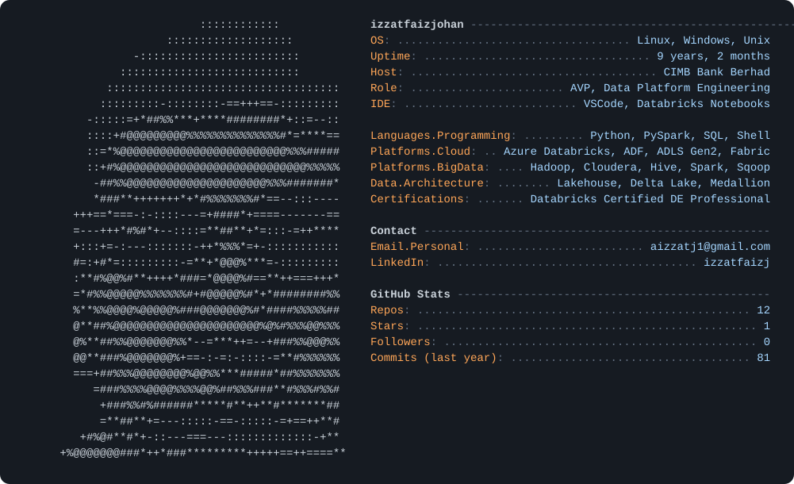

  

<h2 align="center">Hi, I'm Izzat Faiz 👋</h2>

<b>Data Engineer | Big Data & Cloud Data Platform Engineer</b> 📍 Kuala Lumpur, Malaysia

  
  

---

### 🧭 About Me

Data Engineer with **9+ years** of experience in enterprise data engineering, Big Data, and cloud data platforms. I design and build scalable data pipelines with **Azure Data Factory, Azure Databricks, PySpark, Spark SQL and Delta Lake**, and I've run large Hadoop platforms in production. My focus areas are metadata-driven ingestion, incremental processing, **Medallion Architecture**, data quality, performance optimization, CI/CD, and platform operations.

- 🏦 Currently **Assistant Vice President, Data Platform Engineering** at **CIMB Bank**
- 🔄 Working on the bank's **Hadoop → Azure Databricks / Microsoft Fabric** re-platforming (~300 TB)
- 🎓 **Databricks Certified Data Engineer Professional**

---

### 🛠️ Tech Stack

**Data Engineering** 

**Big Data** 

**Cloud & Governance** 

**Databases** 

**DevOps & Tools** 

---

### 💼 Experience

**🏦 CIMB Bank Berhad** · Kuala Lumpur
*Assistant Vice President, Data Platform Engineering* · Mar 2026 – Present
*Manager, DM – Data & Analytics Platform* · Oct 2021 – Feb 2026

- Own the administration and operations of CIMB's **Advanced Analytics Platform**, a **20-node** Oracle BDA/Cloudera Hadoop platform with ~**774 TB** of HDFS storage serving **200+ users**
- Administer the **Azure Databricks** platform: workspaces, **Unity Catalog** permissions, Entra ID user/group provisioning, cluster policies and compute
- Contribute to the enterprise re-platforming from Hadoop to **Azure Databricks, Microsoft Fabric, ADLS Gen2 and Delta Lake**, including migration planning for ~**300 TB** of data and workloads
- Modernize legacy workloads: Hive SQL → Databricks SQL, Sqoop/shell → PySpark, Spark → Databricks Spark
- Support migration validation (reconciliation, SIT/UAT, parallel runs, cutover) and governance with Unity Catalog, Purview, Protegrity and RBAC

**💻 Capgemini Malaysia** · Kuala Lumpur
*Data Engineer* · Jan 2019 – Nov 2021

- Designed a **metadata-driven framework** in Azure SQL to drive ingestion and transformation without per-table pipelines
- Built reusable **Azure Data Factory** pipelines and **Databricks PySpark** Bronze/Silver/Gold layers with metadata-driven merge logic
- Implemented **CI/CD** for ADF and Databricks with GitHub, governance with Unity Catalog and Key Vault, and run alerts with Logic Apps
- Delivered **Databricks AI/BI dashboards** and a natural-language **Genie** agent on curated Gold tables

**🖥️ TCS Malaysia** · Kuala Lumpur
*Big Data Developer* · Aug 2017 – Dec 2018

- Migrated RDBMS data to Hadoop with **Sqoop** (full and incremental loads, split-by tuning)
- Designed **Hive** tables with partitioning, bucketing and ORC/Avro/Parquet formats; automated HDFS ingestion with shell scripts

---

### 📜 Certifications

- 🏅 **Databricks Certified Data Engineer Professional** (2026)
- 🏅 Databricks Lakehouse Platform
- 🏅 Apache Airflow Fundamentals
- 🏅 Scrum Fundamentals
- 🎓 Data Engineering Certificate Scholarship – Yayasan Peneraju

### 🎓 Education

- **Bachelor of Information Technology (Information Systems)**, Universiti Tenaga Nasional · 2014 – 2017
- **Foundation in Information Technology**, Universiti Tenaga Nasional · 2013 – 2014

---

<i>Open to conversations about data platforms, Lakehouse architecture and cloud migration. Feel free to reach out!</i>

